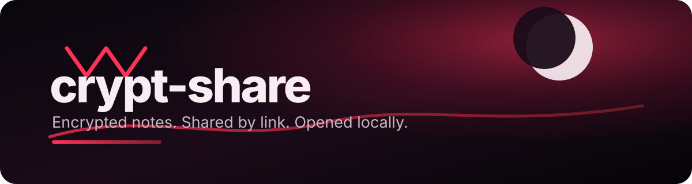

# crypt-share

**Encrypted notes. Shared by link. Opened locally.**

crypt-share is a client-side encrypted text-sharing web app. Write a note, protect it with a passphrase, and share the resulting link or encrypted file. The note is encrypted in the browser with WebCrypto AES-GCM, using a key derived from the passphrase with PBKDF2-SHA-256.

There is no account, no upload, and no server-side copy of the note.

## Features

- Encrypt notes locally in the browser.
- Share ciphertext through a URL fragment.
- Export and import encrypted `.cryptshare.json` files.
- Optional expiry metadata.
- Optional burn-after-reading flag.
- Tamper detection through AES-GCM authentication.
- Responsive dark interface with crimson Vempire styling.
- No plaintext storage and no network calls from the app logic.

## How it works

1. Enter a note and passphrase.
2. crypt-share generates a random salt and IV.
3. PBKDF2-SHA-256 derives a 256-bit AES-GCM key from the passphrase.
4. The note and its metadata are encrypted locally.
5. The encrypted payload is encoded into the URL fragment after `#s=`.
6. The recipient opens the link, enters the passphrase, and decrypts the note locally.

URL fragments are not sent to a web server in normal HTTP requests. That means a static host serving this page does not receive the encrypted payload in the request URL. The link is still sensitive: anyone who has both the link and the passphrase can decrypt the note.

Encrypted-file export contains the same encrypted payload in JSON form. It can be imported on the crypt-share page and decrypted with the passphrase.

## Security notes and honest limits

- Use a long, unique passphrase and share it through a separate trusted channel.
- AES-GCM detects modified ciphertext, but it cannot protect a note if the recipient device or browser is compromised.
- Expiry and burn-after-reading are stored inside the encrypted metadata and enforced by this client. They cannot erase copied links, screenshots, downloaded exports, or text saved by a reader.
- Burn-after-reading removes the fragment from the current browser after a successful open. Other copies of the link may still exist.
- Very long notes can produce links that are awkward to share or exceed practical URL limits in some apps. Use encrypted-file export for larger notes.
- There is no password recovery. A lost passphrase means the note cannot be decrypted.
- The passphrase is never stored by crypt-share. Avoid entering it on a device or browser you do not trust.

## Run locally

WebCrypto requires a secure context. Serve the folder over localhost:

```bash
python3 -m http.server 8000
```

Then open:

```text
http://localhost:8000
```

## Tests

The crypto core is tested with Node's built-in test runner:

```bash
node --test tests/
```

## Project structure

```text
.
├── app.js
├── crypto.js
├── index.html
├── style.css
├── assets/
│   └── banner.svg
└── tests/
    └── crypto.test.mjs
```

## License

MIT License. Copyright (c) 2026 Lavish Gangwar.
